# 🛠️ Awesome Developer Tooling & CLI Utilities

  

  
  
  
  
  
  

---

## 📌 Top Developer Tooling & CLI Utilities Ecosystem

> **Curated List of SaaS / Hosted Platforms & High-Performance Open-Source GitHub Projects**  
> *Focused on All-in-One Developer Swiss-Army Knives, Offline Data Encoders/Decoders, Modern Rust/Go CLI Replacements & Terminal Productivity Suites*  
> **Last updated: November 2026** ⚡

This repository indexes the most powerful **SaaS/hosted developer platforms** and blazing-fast **open-source CLI tools & local utilities**. Whether you need to encode, decode, format, inspect, diff, benchmark, or transform payloads (JSON, YAML, JWT, SQL, Regex, crypto) or upgrade your shell with lightning-fast Rust and Go command-line replacements, this guide has you covered.

---

## 📖 Table of Contents

- [📊 Sector Overview & Market Dynamics](#-sector-overview--market-dynamics)
- [☁️ SaaS & Hosted Platforms](#️-saas--hosted-platforms)
- [💻 Open-Source GitHub Projects](#-open-source-github-projects)
  - [🏆 High-Performance CLI & Terminal Tools (Sorted by Stars)](#-high-performance-cli--terminal-tools-sorted-by-stars)
- [🤝 How to Contribute](#-how-to-contribute)
- [💖 Support & Share](#-support--share)
- [📈 Star History](#-star-history)
- [⚠️ Disclaimer](#️-disclaimer)

---

## 📊 Sector Overview & Market Dynamics

The global software developer tooling and productivity market is estimated at **$7.4B–$8.8B in 2026** (expanding from $6.4B in 2024 at ~15.2% CAGR), while the broader application development software ecosystem exceeds **$375B**. 

The sector is **highly fragmented** rather than winner-take-all: software engineers continuously reject rigid monolithic vendor lock-in in favor of best-of-breed composable micro-utilities, offline-first client-side web tools, and modular Rust/Go command-line utilities adopted through bottom-up Product-Led Growth (PLG).

---

## ☁️ SaaS & Hosted Platforms

Below is the breakdown of leading hosted platforms and commercial developer toolboxes, sorted in descending order by estimated company valuation / annual revenue:

| Company / SaaS Product | Description & Capabilities | Estimated Company Size (Revenue / Valuation) | Starting Pricing Tier | Free Tier Limits / Free Trial |
| :--- | :--- | :--- | :--- | :--- |
| **[Retool](https://retool.com)** | Enterprise internal tool platform, hosted developer utilities, SQL/REST generators, and AI agent workflows. | **$3.2B Valuation** (~$130M ARR) | **$10 / user / month** (billed annually for Team plan; $12/mo monthly) | **Free Forever**: Up to 5 users, standard app building, unlimited view-only apps, and 500 workflow runs/month. |
| **[WebFX Tools](https://webfx.com)** | Tech-enabled digital marketing suite offering free browser-based web developer utilities, minifiers, and schema generators. | **~$168M–$285M Annual Revenue** | **$0** (Free web utility collection; agency SaaS plans from $300/mo) | **Free Forever**: 100% free unmetered web utilities (HTML/CSS/JS minification, `.htaccess` generator, schema tools). |
| **[Raycast](https://raycast.com)** | Next-gen extensible developer command palette, launcher, and AI workspace syncing scripts, snippets, and terminal tasks. | **$100M–$250M Valuation** (~$5.2M ARR) | **$8 / user / month** (billed annually for Pro; $10/mo monthly) | **Free Forever**: Unlimited core commands, custom scripts, community extensions; capped at 3 months clipboard history, 5 notes, no cloud sync, and 0 AI credits. |
| **[Warp](https://warp.dev)** | Modern GPU-accelerated, cloud-connected terminal with AI command generation, workflows, and multi-user session sharing. | **$100M+ Valuation** (Backed by GV & Dylan Field) | **$18 / user / month** (billed annually for Build tier; $20/mo monthly) | **Free Forever**: Core GPU terminal, unlimited local shell sessions, Bring-Your-Own-Key (BYOK) AI; 0 bundled Warp AI credits/month. |
| **[ToolJet](https://tooljet.com)** | Low-code developer application builder, hosted database inspector, and integration workbench. | **~$8.5M Annual Revenue** ($6M+ Seed funding) | **$20 / builder / month** (Basic cloud plan) | **Free Forever**: Up to 2 builders, 50 end-users, 3 applications, and 500 AI credits/month. |
| **[CodeBeautify / Regex101](https://regex101.com)** | Industry-standard regular expression test engine, debugger, syntax explainer, and multi-format code beautifiers. | **~$1M–$2M Est. Annual Revenue** (Bootstrapped / Ad-supported) | **€4.99 / month** (billed annually for Regex101 Pro; €7/mo monthly) | **Free Forever**: Full access to PCRE2/Python/JS/Go regex engines, community library, and beautifiers; Pro removes ads and enables cloud test suites. |
| **[DevUtils](https://devutils.com)** | Offline macOS developer Swiss-army knife with 45+ offline utilities (JWT, JSON, Base64, Unix epoch, regex) and clipboard inspection. | **~$60K Annual Revenue** ($5K MRR, Bootstrapped indie by Tony Dinh) | **$9 - $29 one-time** (Lifetime license / perpetual license options) | **Free 14-Day Full Trial** (Unrestricted access to all 45+ tools without license key); limited free version available on Mac App Store with basic converters. |
| **[ExtendsClass](https://extendsclass.com)** | Online developer sandbox featuring mock REST APIs, JSON/XML/SQL validators, and online storage bins. | **Bootstrapped Indie / Ad-Supported** (<$50K Est. Annual Revenue) | **$0** (Free ad-supported platform) | **Free Forever**: Full access to all online validators; hosted JSON Storage API capped at 10,000 requests/month, 100 KB max bin size, and 10 MB total storage. |

---

## 💻 Open-Source GitHub Projects

### 🏆 High-Performance CLI & Terminal Tools (Sorted by Stars)

Every open-source powerhouse below includes a live stargazer badge linking directly to the repository's stargazers page:

1. **[Stirling-Tools/Stirling-PDF](https://github.com/Stirling-Tools/Stirling-PDF)**   
   *Locally hosted one-stop Swiss-army knife web application handling every PDF merge, split, OCR, and conversion task without telemetry.* 📄

2. **[junegunn/fzf](https://github.com/junegunn/fzf)**   
   *Blazing-fast interactive command-line fuzzy finder written in Go, universally composable with any shell pipeline or text editor.* 🔍

3. **[jesseduffield/lazygit](https://github.com/jesseduffield/lazygit)**   
   *Simple yet powerful terminal UI for Git commands, resolving merge conflicts, staging hunks, and rebasing interactively.* 🐙

4. **[BurntSushi/ripgrep](https://github.com/BurntSushi/ripgrep)**   
   *Ultra-fast line-oriented search tool written in Rust that recursively searches directories for regex patterns while honoring `.gitignore` rules.* ⚡

5. **[sharkdp/bat](https://github.com/sharkdp/bat)**   
   *Modern `cat` clone with syntax highlighting, Git integration gutters, automatic paging, and rich file-type awareness.* 🦇

6. **[starship/starship](https://github.com/starship/starship)**   
   *The minimal, blazing-fast, and infinitely customizable cross-shell prompt for any interpreter (Bash, Zsh, Fish, PowerShell).* 🚀

7. **[sharkdp/fd](https://github.com/sharkdp/fd)**   
   *Simple, fast, and user-friendly alternative to `find`, featuring intuitive syntax, regex search, colorized output, and parallel execution.* 📁

8. **[CorentinTh/it-tools](https://github.com/CorentinTh/it-tools)**   
   *Handy self-hosted collection of 80+ online tools for developers (JWT parsers, Docker Compose converters, UUIDs, hashers, cron generators) built with Vue 3.* 🧰

9. **[ajeetdsouza/zoxide](https://github.com/ajeetdsouza/zoxide)**   
   *Smarter `cd` command inspired by z and autojump, learning your habits to navigate deep directory structures with minimal keystrokes.* ⚡

10. **[httpie/cli](https://github.com/httpie/cli)**   
    *User-friendly, modern command-line HTTP client with intuitive UI, JSON support, colorized terminal output, and persistent sessions.* 🥧

11. **[gchq/CyberChef](https://github.com/gchq/CyberChef)**   
    *The Cyber Swiss Army Knife: browser-based utility for encryption, encoding, compression, and chained recipe data analysis running 100% client-side.* 🍳

12. **[jqlang/jq](https://github.com/jqlang/jq)**   
    *Lightweight and flexible command-line JSON processor: the `sed` for JSON data to slice, filter, map, and transform structures in shell pipelines.* 💎

13. **[dandavison/delta](https://github.com/dandavison/delta)**   
    *Syntax-highlighting pager for Git, diff, and grep output featuring side-by-side view, line numbers, and Git blame inspection.* 🎨

14. **[atuinsh/atuin](https://github.com/atuinsh/atuin)**   
    *Magical shell history replacement storing commands in a SQLite database with end-to-end encrypted sync and contextual search.* 🐢

15. **[DevToys-app/DevToys](https://github.com/DevToys-app/DevToys)**   
    *Cross-platform offline Swiss-army knife for developers (Windows, macOS, Linux, CLI) with smart clipboard detection and 30+ utilities.* 🧸

16. **[sharkdp/hyperfine](https://github.com/sharkdp/hyperfine)**   
    *Command-line benchmarking tool featuring statistical analysis, warmup runs, shell parameter export, and outlier detection.* ⏱️

17. **[Wilfred/difftastic](https://github.com/Wilfred/difftastic)**   
    *Structural diff tool that compares files based on their syntax tree (using Tree-sitter) rather than line-by-line text differences.* 🌲

18. **[eza-community/eza](https://github.com/eza-community/eza)**   
    *Modern, actively maintained replacement for `ls` featuring Git status integration, extended file attributes, icons, and tree layouts.* 🌳

19. **[antonmedv/fx](https://github.com/antonmedv/fx)**   
    *Interactive command-line JSON viewer and processor with folding, search, fuzzy matching, and live JavaScript/jq filtering.* 🪄

20. **[denisidoro/navi](https://github.com/denisidoro/navi)**   
    *Interactive cheatsheet tool for the command line with parameterized snippet execution and fuzzy auto-fill.* 🧭

21. **[ast-grep/ast-grep](https://github.com/ast-grep/ast-grep)**   
    *CLI tool for structural code search, linting, and rewriting using Abstract Syntax Trees across multiple programming languages.* ⚡

22. **[mikefarah/yq](https://github.com/mikefarah/yq)**   
    *Portable command-line YAML, JSON, XML, CSV, TOML, and properties processor built on Go for deep document queries and mutations.* 📑

23. **[XAMPPRocky/tokei](https://github.com/XAMPPRocky/tokei)**   
    *Blazing-fast CLI program that counts lines of code, comments, blanks, and language breakdowns across millions of files in seconds.* 📊

24. **[darrenburns/posting](https://github.com/darrenburns/posting)**   
    *Modern terminal-based HTTP/API client with keyboard-driven UI, request collections, and variable environments inside the shell.* 📬

25. **[iib0011/omni-tools](https://github.com/iib0011/omni-tools)**   
    *Self-hosted open-source collection of web-based utilities for image, PDF, and code transforms running on private infrastructure.* 🗂️

26. **[chmln/sd](https://github.com/chmln/sd)**   
    *Intuitive find-and-replace CLI tool and modern `sed` alternative with standard regex syntax and multi-line matching.* ✂️

27. **[tealdeer-rs/tealdeer](https://github.com/tealdeer-rs/tealdeer)**   
    *Ultra-fast implementation of `tldr` command-line cheatsheets written in Rust with local caching and colored syntax highlighting.* 🦌

28. **[dundee/gdu](https://github.com/dundee/gdu)**   
    *Fast disk usage analyzer with an interactive console interface written in Go, specifically optimized for SSDs and large drive trees.* 💾

29. **[PaulJuliusMartinez/jless](https://github.com/PaulJuliusMartinez/jless)**   
    *Command-line JSON viewer designed for reading, exploring, and navigating large JSON payloads with vim-like navigation.* 🔬

30. **[IvanMathy/Boop](https://github.com/IvanMathy/Boop)**   
    *Scriptable scratchpad for developers on macOS for instant client-side text conversions, formatting, and custom JavaScript scripts.* 🧼

---

## 🤝 How to Contribute

Contributions are warmly encouraged! Help keep this ecosystem up to date:

1. 🍴 **Fork the repository**.
2. 🌿 **Create a feature branch** (`git checkout -b feature/add-new-tool`).
3. 📝 **Add/edit entries in [README.md](README.md)**:
   - For SaaS products: include starting pricing tier, specific free tier limits, and estimated company scale.
   - For Open-Source tools: include a shield badge linked to stargazers and maintain the descending star sort order.
4. 🚀 **Submit a Pull Request** with a clear description of why the tool is beneficial to the developer community.

---

## 💖 Support & Share

Thank you for exploring and utilizing this curated developer tooling ecosystem! If you find this guide valuable:

- ⭐ **Star this repository** to help other engineers discover modern CLI & developer tools.
- 🍴 **Fork and share** with your team, coworkers, or developer community on X/Twitter, LinkedIn, and Reddit.
- ☕ **Buy me a coffee & support my open-source work**: Sponsor the creator via the [GitHub Sponsors Dashboard](https://github.com/sponsors/ishandutta2007) to help maintain and expand these developer tool databases!

  

---

## 📈 Star History

---

## ⚠️ Disclaimer

- This is a **community-curated guide** intended for informational and educational purposes.
- **Security & Privacy Caution**: Never paste production JWT secrets, private RSA/SSH keys, enterprise database connection strings, or customer PII into third-party hosted web utilities; prefer offline local tools (`DevToys`, `Boop`, CLI tools) or isolated self-hosted Docker containers (`IT-Tools`, `CyberChef`).
- Always inspect external binaries and verify SHA256 checksums before running arbitrary remote install scripts (`curl -sSL | sh`).

---

  <b>Built with ❤️ for Software Engineers, DevOps/SREs, System Administrators, and CLI Power Users.</b>

